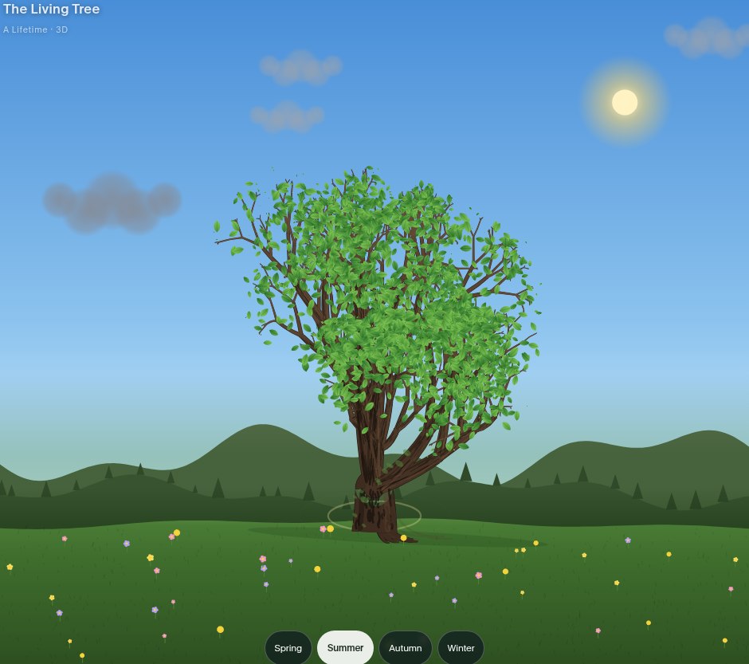
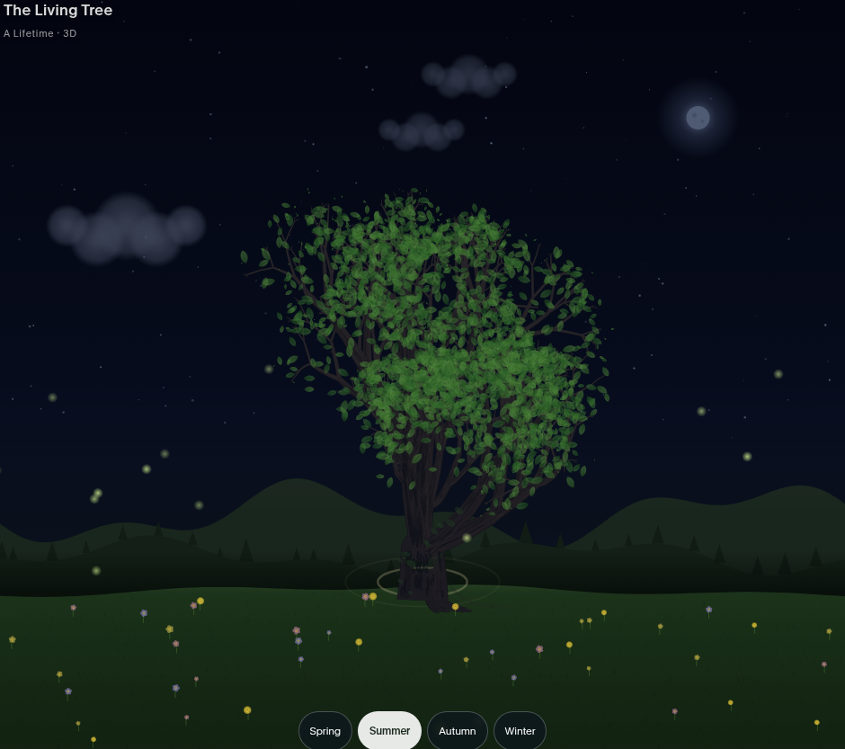

# The Living Tree: A Lifetime 3D

Grow a tree with your fingertip: hold the ground by the roots and a sapling becomes a giant. Four living seasons, rain, snow, day and night, all in walk-around 3D. Pure HTML/CSS/JS canvas, no libraries.

## Controls

- Hold the ground by the roots to grow the tree.
- Add a second finger on the ground to make it young again.
- Drag to look around the tree.
- Tap the sun for night, the moon for day.
- Tap the storm cloud to change the weather.
- Use the season buttons to switch between spring, summer, autumn and winter.

